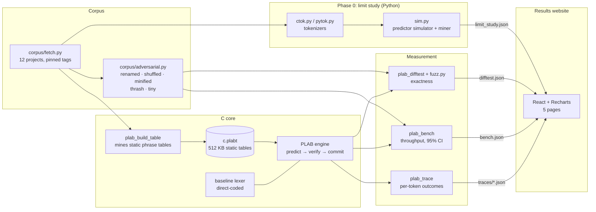
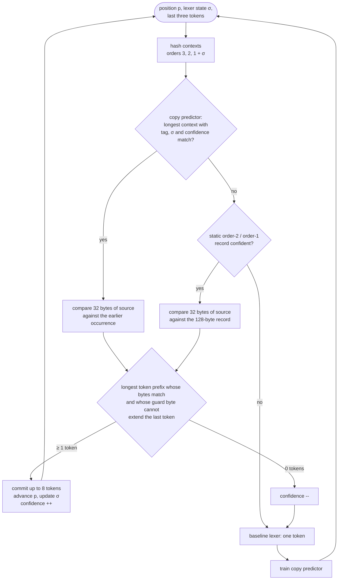
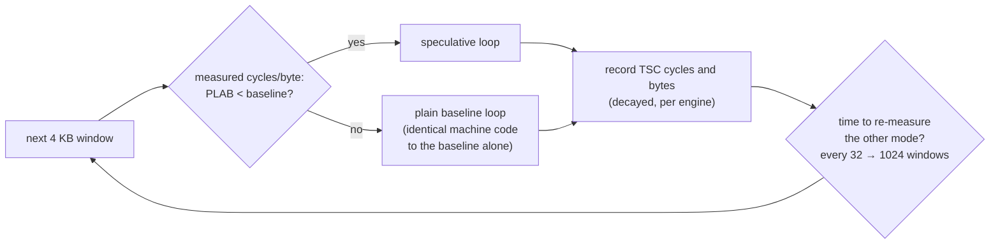

# PLAB: Predictive Lexical Analysis Buffering

> Can a lexer go faster by **guessing whole phrases of tokens** instead of scanning byte by byte?

Source code is repetitive. After `for (int`, the next few tokens are very often ` i = 0; i <`. PLAB tries to exploit that: it predicts the next phrase from the last tokens it saw, verifies the prediction against the source with **one 32-byte SIMD compare**, and commits every matching token at once. When the guess is wrong, an ordinary lexer takes over for one token.

This repository is a complete research implementation of that idea for C (and Python, in simulation). It contains a C engine, a Phase 0 simulator, a 12-project corpus pipeline, an exactness test harness and fuzzer, a benchmark suite, and an interactive results website. The question gets a measured answer.

**The short answer:** PLAB is **provably exact**, and with a measured governor it is **safe** (at most 2.3% slower on hostile input). It predicts **45% of tokens**, but it is **not faster** than a well-written direct-coded lexer on a modern x86 CPU. The reasons are measured, not guessed, and are laid out below.

---

## Contents

- [Results at a glance](#results-at-a-glance)
- [Architecture](#architecture)
- [How PLAB works](#how-plab-works)
- [Why it is not faster](#why-it-is-not-faster)
- [Repository layout](#repository-layout)
- [Getting started](#getting-started)
- [The results website](#the-results-website)
- [Methodology](#methodology)
- [Deviations from the spec and limitations](#deviations-from-the-spec-and-limitations)
- [Where this could go next](#where-this-could-go-next)

---

## Results at a glance

Measured on an Intel Core i9-14900HX (Windows 11, MinGW-w64 gcc 16, `-O2 -march=native`) against a hand-written, re2c-style direct-coded lexer running at about **430 MB/s (≈ 37 cycles per token)**.

| Hypothesis | Target | Result | |
| --- | --- | --- | --- |
| **H1 Coverage** | ≥ 50% of tokens predicted, ≥ 3 tokens per phrase | **45.0%** (C), **44.5%** (Python), 2.25 tokens per phrase | ❌ not met |
| **H2 Speed** | ≥ 1.5× over re2c | **0.99×** with the governor; 0.27× with prediction forced on | ❌ not met |
| **H3 Mechanism** | mispredicts −40%, instructions/byte ÷ 2 | no hardware performance counters on Windows | ⚠️ untested |
| **H4 Robustness** | ≤ 5% slowdown on adversarial input | **2.3%** worst case (minified code) | ✅ met |
| **H5 Exactness** | token stream always identical to the baseline | **0 divergences** across 2,410 files, 7.3M tokens, 12 configurations; 0 fuzz failures | ✅ met |

What changed along the way:

| | First implementation | Final |
| --- | --- | --- |
| Token coverage (C) | 31.2% | 45.0% |
| Throughput vs baseline | 0.78× | 0.99× |
| Worst adversarial slowdown | 64.3% | 2.3% |

---

## Architecture

### System overview



`scripts/run_all.py` drives the whole pipeline end to end.

### The speculative hot loop



### The governor

Every 4 KB window runs either the speculative loop above or the plain baseline loop. The governor measures both and keeps the cheaper one.



---

## How PLAB works

### 1. Predict

Every position after a token has a **context**: the identities of the last tokens (a stable spelling hash for identifiers, the kind for everything else) plus **σ**, a 4-bit lexer state signature (at line start, inside a directive, after `#include`, expecting a directive name). Three predictors propose a phrase, in order:

| Predictor | State | What it proposes |
| --- | --- | --- |
| **Copy (cascade)** | 32 KB per file: order-3, -2 and -1 tables (2048/1024/1024 entries) | What followed the same context earlier in this file |
| **Static order-2** | 256 KB, 2048 records, mined offline | The most valuable phrase seen after this context in the training corpus (git, curl, Linux) |
| **Static order-1** | 256 KB, 2048 records | The same, keyed by the last token only |

A phrase is at most **8 tokens** and **32 bytes**, including the whitespace and comments between tokens.

### 2. Verify, exactly

Predictions are only ever **verified, never trusted**. For a phrase starting at byte `p` in state σ:

1. One AVX2 compare finds `a`, the number of leading bytes that match.
2. A token ending at offset `b` may be committed only if `b ≤ a` and the **guard byte** `src[p + b]` is not in `EXTENDS[kind]`, the set of bytes that could make that token longer. For example, an identifier followed by a letter, or `-` followed by `>`.
3. The longest safe prefix is committed: partial acceptance.

Because the lexer's decision at every token end depends only on σ, the matched bytes and that one guard byte, the committed tokens are exactly what the baseline would have produced. `EXTENDS` is derived mechanically from the punctuator table, so it can over-approximate (losing a little coverage) but never under-approximate.

### 3. Commit and train

Committed tokens are written straight into the structure-of-arrays token buffer (`kind`, `start`, `len`, intern `id`, `σ`). Tokens the baseline lexes train the copy predictor. A 2-bit confidence counter per entry, plus an 8-bit fingerprint of the next token, decide whether a context is trusted.

---

## Why it is not faster

This is the main finding, and every number below was measured.

**1. Coverage plateaus.** Sweeping the static budget (32 KB → 2 MB), context order (1 to 4), window size (16 to 64 bytes), confidence thresholds and probe counts never pushes coverage past about **45%**. Phrases average **2.25 tokens**, because a single differing identifier ends a match.

**2. Bookkeeping costs as much as lexing.** The baseline spends about **37 cycles per token**. The spec's cost model assumed a phrase commit costs about 10 cycles. In practice:

| Cost (prediction forced on) | Cycles/byte | vs baseline |
| --- | --- | --- |
| Baseline alone | 5.29 | 1.00× |
| Static tables only (no training at all) | 8.06 | 0.66× |
| Copy predictor trained 1 in 64 positions | 10.51 | 0.50× |
| Copy predictor trained 1 in 16 | 12.05 | 0.44× |
| Copy predictor trained 1 in 4 | 14.39 | 0.37× |
| Copy predictor trained at every token | 19.70 | 0.27× |

Even with **zero training**, PLAB is 34% slower. Hashing the context, looking it up and tracking the last tokens costs 10–12 cycles per token before anything is predicted. Training a three-level copy predictor costs about 20–25 cycles per update. Each was isolated experimentally: enqueue-only and flush-only variants, batch sizes, table sizes from 4 KB to 32 KB, and branch-free updates.

**3. The arithmetic closes the door.** Plugging the measured numbers into the spec's own model, `S(a) = C_ref / (a·C_hit/n + (1−a)·(C_ref + F))`, gives a speedup of at most about **1.3×** at 45% coverage even if accepted phrases were free. Reaching 1.5× at realistic costs needs about 68% coverage.

**What does work:**

- The **exactness technique** (guard bytes, EXTENDS sets, σ) is sound under every configuration tested.
- The **measured governor** turns a 3–4× slower optimization into one that costs at most 2.3% on the worst input. It's a reusable pattern for shipping any speculative fast path.
- The **cascade copy predictor** raised coverage from 31% to 45% in the same 32 KB of state.

---

## Repository layout

```
.
├── PLAB_SPEC.md            the technical specification (the contract)
├── DESIGN_NOTES.md         layout, deviations from the spec, current results
├── corpus/
│   ├── fetch.py            shallow, tag-pinned clones of the 12 corpus projects
│   ├── adversarial.py      generates the adversarial set
│   ├── adversarial/        renamed · shuffled · minified · thrash · tiny
│   └── manifest.json       exact revisions used
├── limitstudy/             Phase 0 in Python
│   ├── ctok.py             regex maximal-munch C tokenizer with σ
│   ├── pytok.py            Python tokenizer adapter (byte offsets)
│   ├── sim.py              predictor simulator and static-table miner
│   └── run.py              sweeps → results/limit_study.json
├── core/                   the C implementation
│   ├── include/plab.h      public API: token kinds, σ, 128-byte record, engine
│   ├── src/lex_inline.h    baseline direct-coded lexer
│   ├── src/lex.c           EXTENDS sets, σ transitions, baseline loop
│   ├── src/engine.c        predictors, verification, commit, training, governor
│   ├── src/intern.c        identifier interner with per-run epochs
│   ├── src/table.c         .plabt static table I/O
│   ├── tools/              plab_build_table · plab_difftest · plab_bench · plab_trace
│   └── tests/              unit tests, mutation fuzzer, regression inputs
├── tables/                 mined static tables (c.plabt, c_kind.plabt)
├── results/                limit_study.json · bench.json · difftest.json
├── scripts/run_all.py      the full pipeline
└── web/                    results website (Vite, React 18, TypeScript, Tailwind, Recharts)
```

---

## Getting started

### Requirements

- A C11 compiler (gcc or clang), CMake ≥ 3.16 and Ninja. AVX2 is used when available, with a scalar fallback otherwise.
- Python 3.11+
- Node.js 18+ (for the website)
- git (for fetching the corpus)

### Just look at the results

The results and traces are committed, so the website works straight after cloning:

```bash
cd web
npm install
npm run dev          # http://localhost:5173
```

### Reproduce everything

```bash
python corpus/fetch.py          # ~1.5 GB of shallow clones, once
python scripts/run_all.py       # build → lists → adversarial → tables → difftest
                                #   → fuzz → bench → traces → limitstudy → sync
```

Or run individual steps:

```bash
python scripts/run_all.py build tables difftest
python scripts/run_all.py bench sync
ctest --test-dir core/build     # lexer unit tests + regression replay
```

### Use the tools directly

```bash
# exactness: compare PLAB with the baseline under every configuration
core/build/plab_difftest --table tables/c.plabt --kind-table tables/c_kind.plabt file1.c file2.c

# mine your own static tables from a list of training files
core/build/plab_build_table --list train.txt --out my.plabt --max-mb 32

# per-token trace for the inspector
core/build/plab_trace --table tables/c.plabt --list traces.txt --out-dir web/public/traces
```

---

## The results website

| Page | What it shows |
| --- | --- |
| **Overview** | Headline numbers against each hypothesis, a one-line finding generated from the data, coverage by language and predictor |
| **Limit Study** | Coverage vs static budget (log scale) with break-even lines per baseline class; context order and window sweeps; phrase-length histogram; commits by predictor source |
| **Benchmarks** | Throughput per project with 95% CI whiskers, PLAB/baseline ratios, adversarial slowdowns against the 5% line, ablations, cycles per byte |
| **Token Inspector** | Real source files with every token tinted by outcome (committed, partial, failed probe, fallback), phrase underline bands coloured by predictor, hover cards showing expected vs actual bytes, top committed phrases. Virtualized, so a 10,000-line file stays smooth |
| **Cost Model** | Live sliders for the spec's cost model, the break-even point, and markers at the measured coverage |

Colours mean the same thing on every page: **green** committed, **teal** partial, **amber** failed probe, **grey** fallback, **blue** the subject of the chart. Light and dark themes are both supported.

---

## Methodology

**Corpus.** Training: git, curl and Linux (`kernel/`, `mm/`, `fs/`) for C; CPython `Lib/` and Django for Python. Testing: sqlite, redis, lua and nginx; requests, flask and rich. All are shallow clones pinned to release tags (see `corpus/manifest.json`).

**Adversarial set.** Identifiers renamed to random strings; lines shuffled inside each function; whitespace and comments minimized; a synthetic generator that alternates two continuations per context to thrash confidence counters; and real files cut into pieces under 1 KB.

**Exactness.** `plab_difftest` compares PLAB's token arrays with the baseline's element by element (kind, start, length, intern ID, σ, line count) under 12 configurations, covering every ablation. It prints the first divergence with 40 bytes of context. `core/tests/fuzz.py` mutates inputs at token boundaries using bytes from the EXTENDS sets, and duplicates nearby code so copy predictions almost match. Any failing input is saved to `core/tests/regressions/` and replayed by `ctest`.

**Benchmarks.** The pinned thread runs at high priority. Baseline and PLAB runs are interleaved, 30 runs per project. The report gives the median with a distribution-free 95% confidence interval. Cycles are TSC reference cycles.

**Ablations.** Spec predictors, copy only, static only, kind-only contexts, no partial acceptance, exact guard bytes only, no intern-ID caching, no prefetch, governor off, W = 16, and sampled training.

---

## Deviations from the spec and limitations

All deviations are intentional and documented in [`DESIGN_NOTES.md`](DESIGN_NOTES.md). The main ones:

- **No re2c or flex.** They were not available, so the baseline is a hand-written lexer in re2c's direct-coded style. It is fast, about 37 cycles per token, which makes PLAB's job harder rather than easier.
- **An extra σ bit** marks "right after the `#` that starts a directive". Without it, entering `#include` mode depends on the previous token rather than on σ, and exactness breaks.
- **Context identity** uses a stable spelling hash, so tables mined offline match at run time.
- **The token buffer** is sized `len + 64`, not `len/2 + 64`, because `a+b` has three one-byte tokens.
- **The governor** measures real cycles instead of using the spec's assumed constants, which were off by a factor of 3 to 30.
- **H3 is untested.** Windows exposes no hardware performance counters, so instructions, branch mispredictions and cache misses are reported as "not measured".
- **One machine.** All results come from one CPU; others may differ.

---

## Where this could go next

1. **Measure H3** on Linux with `perf`: branch mispredictions and instructions per byte for both modes.
2. **Benchmark against real re2c and flex.** A slower, table-driven baseline (flex) is where the cost model predicts PLAB could pay off.
3. **Hardware or SIMD-batched prediction.** The software bookkeeping is the bottleneck. A predictor that hashes and trains many positions per instruction, or lives in hardware, changes the arithmetic.
4. **Reuse the safety pieces.** Guard-byte exactness and the measured governor apply to speculative parsing, speculative decoding and other fast paths.

---

## License

No license has been chosen yet. All rights are reserved by the author until one is added. The corpus projects are not redistributed here; `corpus/fetch.py` clones them from their upstream repositories under their own licenses.
